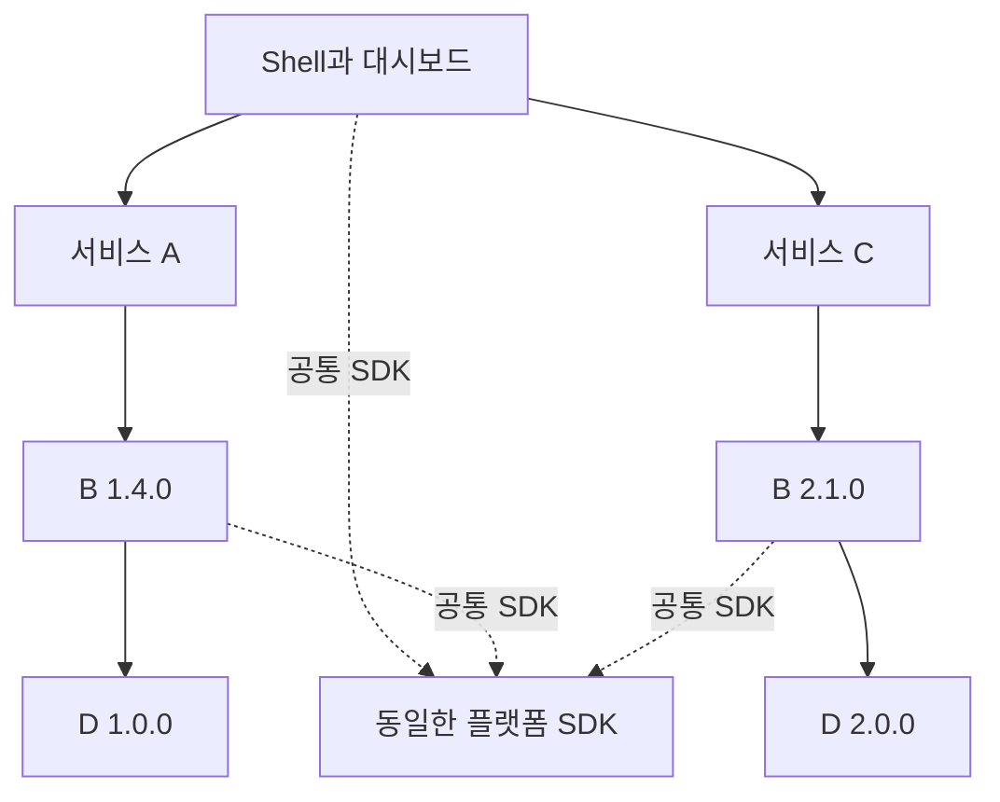

# [초기 설계 기록] MF 플랫폼과 서비스의 독립 배포 설명서

> **현재 구현 안내가 아닙니다.** 논의가 진행되던 시점의 기록을 보존한 파일입니다. 처음 읽는 분은 [입문 설명서](mfe-platform-versioning-guide.html)부터 시작하고, 실제 개발·운영은 HTML 설명서 묶음을 기준으로 확인하세요. 아래의 미구현·미결정 표현은 당시의 상태입니다.

기준일: 2026년 11월 7일

> 이 파일은 중앙 SDK 선택을 구현하기 전의 설계 기록입니다. 최신 구현·실행 방법·검증 결과는 [HTML 설명서](mfe-platform-versioning-guide.html)를 확인하세요.

여러 서비스가 같은 플랫폼을 사용하면서 각자 개발·배포하고, 한 화면에서는 서로 다른 서비스 버전을 함께 실행하는 구조를 설명한다. 현재 프로젝트의 구현, 실행 방법, 플랫폼 업데이트 시 재빌드를 줄이는 변경 방법과 근거를 함께 정리한다.

**이 구조의 공통 조건은 한 화면에서 같은 플랫폼 SDK와 React 실행 환경을 사용하는 것이다. 서비스들의 자체 버전 번호까지 같을 필요는 없다.** 플랫폼 SDK의 호환 업데이트를 서비스 재빌드 없이 적용하려면, SDK 선택을 실행 시점에 중앙에서 결정하도록 구현해야 한다.

현재 구현은 **독립 프로젝트와 서비스 복수 버전의 공존까지 검증한 PoC**다. 플랫폼 SDK의 중앙 런타임 선택은 아래에 정리한 **변경 설계**이며, 아직 코드에 적용하지 않았다.

## 1 먼저 구분할 세 가지 버전

| 구분 | 의미 | 예시 |
|---|---|---|
| 서비스 릴리스 버전 | 해당 팀이 배포하는 코드의 버전 | B 1.4.0, B 2.1.0 |
| 배포 ID | 실제 빌드 산출물을 식별하는 값 | `b_1_4_0_34cbe2c6e79d` |
| 계약 버전 | 소비자가 기대하는 공개 API와 동작의 버전 | 플랫폼 계약 1.x |

현재 빌드 도구는 서비스명·릴리스 버전·소스·설정·잠금 파일·의존 선택 등을 이용해 배포 ID를 만든다. 같은 릴리스 번호라도 입력이 바뀌면 ID가 달라진다. 운영에서는 변경된 릴리스를 새 버전으로 발행하고 기존 파일을 보존한다.

계약에는 함수 이름과 인자뿐 아니라 반환값, Provider 사용 방법, 이벤트 의미, 오류 처리와 정리 책임도 포함한다. 내부 성능 개선은 같은 계약을 유지할 수 있다. 기존 필수 필드를 없애거나 동작의 의미를 바꾸면 계약에 영향을 준다.

SemVer는 공개 API의 호환성을 버전 번호로 표현하는 규칙이다. 버전 번호 자체가 호환성을 검사해 주지는 않는다. [SemVer 공식 명세](https://semver.org/)

계약을 구분한다고 반드시 버전 번호를 두 벌 관리해야 하는 것은 아니다. 아래 변경 설계에서는 SDK의 릴리스 버전을 공개 API 기준으로 관리하고, 서비스가 지원 SDK 버전 범위를 선언하는 방식으로 시작한다.

**현재 코드는 정확한 배포 ID를 고정한다. 계약 범위 선언과 자동 호환성 검사는 아직 구현하지 않았다.**

## 2 플랫폼과 Shell과 서비스의 역할

플랫폼은 여러 서비스가 사용하는 공통 기반 전체를 말한다. 플랫폼팀은 Shell, 실행용 SDK, 개발·빌드 도구를 각각 제공한다.

| 구성 | 현재 역할 | 전달 방식 |
|---|---|---|
| Shell | 헤더·사이드바, 공통 Provider 설정, 원격 서비스 로딩 | 독립 웹 앱의 정적 파일로 시작 |
| 플랫폼 SDK | Context, Hook, 위젯별 상태·캐시·구독·팝업 영역 | MF Remote |
| 플랫폼 빌드 도구 | 배포 ID, MF 설정, CSS 설정, 소스 경계 검사 | 각 프로젝트가 설치하는 npm tarball |
| A와 C | 자신이 선택한 B 위젯을 사용하는 서비스 | 각각 MF Remote |
| B | 공개 위젯 구현, D 모듈 사용 | 버전별 MF Remote |
| D | B가 사용하는 하위 모듈 | 버전별 MF Remote |
| 통합 검증 프로젝트 | 로컬 산출물 저장소, 등록부, 자동 검사 | 별도 Node 프로젝트 |

현재 검증 화면에서는 대시보드를 Shell 안에 구현했다. Shell은 공통 틀과 로딩을, 대시보드는 위젯 배치를 담당한다. 서비스가 내보내는 위젯에는 글로벌 헤더와 사이드바가 들어 있지 않다.



A와 C는 각 B를 통해 공통 플랫폼을 사용한다. D는 현재 플랫폼에 의존하지 않는다.

Shell도 npm으로 서비스에 포함하지 않는다. 브라우저가 HTML과 Shell 진입 파일을 받아 시작하고, Shell이 MF 모듈들을 조합한다. 현재 Shell 자체를 다른 앱이 MF로 가져오는 상위 호스트는 구현하지 않았다.

빌드 도구를 npm으로 설치하는 것과 실행 코드를 MF로 가져오는 것은 함께 사용할 수 있다. 현재 `vendor/`의 tarball에는 빌드 도구가 들어 있으며, 플랫폼 SDK 구현은 MF로 로드한다.

## 3 같은 플랫폼을 쓴다는 조건의 정확한 의미

이 프로젝트에서는 **한 문서 안에서 같은 React 트리를 구성하는 서비스들이 하나의 플랫폼 SDK 모듈과 동일한 React·ReactDOM을 공유**한다. Shell 1.0과 SDK 1.1처럼 각 프로젝트의 릴리스 번호가 다른 것은 가능하다. 중요한 것은 같은 화면에 올라온 서비스들이 실제로 어느 공통 실행 코드를 쓰는가이다.

Provider와 Hook가 서로 다른 Context 객체를 참조하면 값이 연결되지 않을 수 있다. React는 제공하는 쪽과 읽는 쪽의 Context가 `===`로 같은 객체여야 한다고 명시한다. 따라서 SDK 버전 문자열만 같다고 충분한 것은 아니다. [React useContext 주의 사항](https://react.dev/reference/react/useContext#caveats)

현재 빌드 설정은 React·ReactDOM에 `singleton: true`, `strictVersion: true`, 설치된 정확한 버전의 `requiredVersion`을 적용한다. 이 정책 아래에서는 React 버전이 달라질 때 해당 의존성을 가진 프로젝트들도 맞춰 빌드해야 한다. Webpack은 singleton 공유와 요구 버전 검사를 제공한다. [Webpack 공유 설정](https://webpack.js.org/plugins/module-federation-plugin/#sharing-libraries)

이것은 **현재 선택한 공통 React 실행 구조의 조건**이다. 모든 MFE 구현이 반드시 같은 React 버전을 사용해야 한다는 뜻은 아니다.

### 공통 플랫폼 외에 서비스별로 분리하는 것

| 충돌 대상 | 현재 구현한 구분 |
|---|---|
| B 두 버전의 MF container | 배포 ID마다 다른 container 이름 |
| Webpack 청크와 런타임 | 배포 ID마다 다른 `output.uniqueName` |
| 위젯 스타일 | 배포 ID가 포함된 CSS Modules 클래스 |
| 위젯 상태와 캐시 | `WidgetBoundary`를 mount할 때마다 별도 생성 |
| 이벤트 구독 | 인스턴스별 등록과 unmount 정리 |
| 팝업 DOM | 인스턴스별 portal 영역 |

Webpack의 `output.uniqueName`은 여러 빌드의 런타임 전역 이름을 구분하는 설정이다. CSS Modules는 로컬 클래스 이름을 변환하며, 현재 적용한 `pure` 모드는 선택자에 로컬 클래스나 ID가 포함되도록 요구한다. [Webpack uniqueName](https://webpack.js.org/configuration/output/#outputuniquename), [css-loader 공식 설명](https://github.com/webpack/css-loader#scope)

같은 B 1.4 위젯을 두 개 띄워도 배포물은 하나를 재사용하면서 상태는 두 인스턴스로 나눈다. **버전별 코드 분리와 인스턴스별 상태 분리는 모두 필요하다.**

이 규칙은 임의의 코드가 `window`, DOM, 저장소를 직접 변경하는 것까지 막는 보안 격리는 아니다. CSS 상속과 외부 라이브러리의 전역 부작용도 별도 검토가 필요하다.

## 4 MF로 가져오는 것과 버전을 선택하는 시점

MF는 다른 빌드의 모듈을 실행 중에 가져오게 한다. 사용할 배포물까지 실행 시점에 결정하는지는 연결 설정에 달려 있다.

| 연결 방식 | 파일을 가져오는 시점 | 배포물을 선택하는 시점 | 새 배포물 채택 |
|---|---|---|---|
| 현재 SDK 연결 | 실행 시점 | 서비스 빌드 시점에 이름·URL 고정 | 해당 소비자 빌드 변경 |
| 제안하는 SDK 연결 | 실행 시점 | 공통 시작 설정에서 선택 | 검증 후 등록부 선택 변경 |

현재 코드는 다음과 같은 실제 값을 서비스 번들에 연결한다.

```js
platform:
  'mf_platform_1_0_0_802cdc01ce90@/artifacts/platform_1_0_0_802cdc01ce90/remoteEntry.js'
```

SDK 1.1을 다른 경로에 발행해도 이 번들은 계속 SDK 1.0의 경로를 요청한다. 이것이 현재 구현에서 재빌드가 발생하는 이유다.

Webpack은 `get`과 `init` 인터페이스를 제공하는 container를 런타임에 연결할 수 있고, `remotes`에 Promise를 사용해 실행 중에 대상을 결정할 수도 있다. 이 기능을 중앙 SDK 선택에 활용하는 것이 아래 변경 설계다. [Dynamic Remote Containers](https://webpack.js.org/concepts/module-federation/#dynamic-remote-containers), [Promise Based Dynamic Remotes](https://webpack.js.org/concepts/module-federation/#promise-based-dynamic-remotes)

## 5 현재 구현의 버전 선택과 재빌드 범위

| 연결 | 현재 선택 위치 | 코드 근거 |
|---|---|---|
| Shell → A와 C | 실행 시 읽는 `registry.json` | [Shell bootstrap](../projects/shell/src/bootstrap.jsx), [로더](../projects/shell/src/loader.js) |
| A → B 1.4 | A의 `mf.dependencies.json` | [A의 의존 설정](../projects/service-a/mf.dependencies.json) |
| C → B 2.1 | C의 `mf.dependencies.json` | [C의 의존 설정](../projects/service-c/mf.dependencies.json) |
| B → D | 각 B의 `mf.dependencies.json` | [B 1.4 설정](../projects/service-b-v1/mf.dependencies.json), [B 2.1 설정](../projects/service-b-v2/mf.dependencies.json) |
| Shell과 B → SDK | 각자의 `mf.dependencies.json` | [Shell 설정](../projects/shell/mf.dependencies.json), B 설정 |

[빌드 도구](../projects/platform-build-tools/lib/project.cjs)는 이 설정의 `name`과 `entry`를 MF 연결로 변환하고, 의존 설정도 배포 ID 계산에 포함한다. 따라서 현재 플랫폼 SDK를 바꾸면 다음 흐름이 생긴다.

```text
새 플랫폼 SDK 빌드·발행
  → 새 SDK를 선택한 Shell, B 1.4, B 2.1을 재빌드
  → 새 B 배포 ID를 선택한 A, C를 재빌드
  → 호환되는 Shell·A·C 조합을 함께 활성화
```

D의 의존 관계에는 SDK가 없으므로 이 SDK 변경 때문에 D까지 재빌드할 필요는 없다. B의 업무 API가 그대로여도 SDK 선택이 빌드 입력에 포함되므로 B 배포 ID는 달라진다.

[현재 등록부 구현](../integration/tools/store.cjs)은 선택한 의존 그래프에 서로 다른 플랫폼 SDK 배포 ID가 있으면 활성화를 거절한다. Shell만 새 SDK로 바꿔 먼저 활성화하면 기존 B와 조건이 맞지 않는다.

각 산출물은 먼저 따로 발행할 수 있다. 준비된 조합의 **활성화 시점**을 맞추는 것이며 모든 팀이 동시에 빌드 버튼을 누를 필요는 없다. 현재 CLI는 A·C·Shell 중 하나씩 활성화하고, 내부 `activate` 함수는 여러 선택을 함께 받는다. 전체 SDK 이전을 위한 일반 CLI는 아직 없다. `bootstrap`은 검증용 전체 조합을 재생성하는 명령이다.

## 6 제안하는 플랫폼 SDK 중앙 선택 구조

목표는 **업무 서비스의 버전 선택은 유지하면서, 공통 SDK만 화면 시작 시 중앙에서 하나로 결정**하는 것이다.

```text
화면 시작 설정 한 번 읽기
  ├ 이 화면의 SDK = 1.1.0
  ├ 이 화면의 A = 기존 배포물 → B 1.4 → D 1.0
  └ 이 화면의 C = 기존 배포물 → B 2.1 → D 2.0

Shell과 두 B의 platform/sdk 요청
  → 모두 위에서 선택한 동일한 SDK container로 연결
```

서비스는 특정 SDK 배포 ID 대신 자신이 지원하는 SDK 버전 범위를 선언한다. 이 범위는 서비스가 기대하는 공개 계약의 호환 범위를 나타낸다. 다음은 **추가할 메타데이터의 일부를 보여 주는 예시**이며 현재 파일에 바로 넣을 수 있는 형식은 아니다.

```json
{
  "requires": {
    "platformSdk": ">=1.0.0 <2.0.0"
  }
}
```

등록부는 실제 SDK 배포 ID와 버전을 기록한다. 활성화할 때 Shell·서비스·간접 의존성의 요구 범위를 모두 만족하는지 검사한다. 범위 검사를 통과한 뒤에도 기존 서비스 산출물을 이용한 동작 검증이 필요하다. 배포물의 React 요구 버전도 메타데이터에 기록해 공통 실행 환경을 검사한다.

예를 들어 SDK 릴리스 1.1.0이 기존 계약을 유지하며 성능만 개선했다면, 기존 A·B·C 파일을 그대로 두고 새 SDK를 선택할 수 있다. 새 SDK 기능을 사용하도록 B 코드를 바꾼다면 그 B는 새로 빌드해야 한다.

### 한 화면에서는 선택을 고정한다

1. SDK를 import하기 전에 시작 설정을 읽는다.
2. 선택한 SDK와 서비스 목록을 그 화면의 고정된 설정으로 보관한다.
3. 공통 SDK 로더를 준비하고 Shell을 시작한다.
4. 나중에 위젯을 추가해도 처음 선택한 SDK를 사용한다.
5. 등록부를 바꿔도 열린 화면의 SDK는 교체하지 않는다. 새 진입·새로고침부터 새 선택을 사용한다.

이때 설정을 읽는 도중 Shell과 등록부가 서로 다른 배포 조합을 가리키지 않도록, 같은 배포 조합 식별자로 묶는 기능도 필요하다. 각 위젯이 로드될 때마다 별도로 `latest`를 조회하는 방식은 사용하지 않는다.

이 흐름에서 Shell 내부 레이아웃 수정은 Shell만, 호환되는 SDK 내부 개선은 SDK와 공통 선택만 배포하면 된다. SDK 공개 계약을 깨는 변경은 영향을 받는 서비스를 이전하고 호환 조합으로 전환해야 한다. 현재의 정확한 React 버전 고정 정책을 유지한다면 React 변경도 관련 프로젝트의 재빌드 대상이다.

## 7 중앙 선택으로 전환하는 작업 순서

**아래는 아직 수행하지 않은 코드 변경 작업이다.** 현재 고정된 SDK 연결을 없애기 위한 최초 전환에는 관련 프로젝트의 한 차례 재빌드가 필요하다. 전환 이후의 호환 SDK 업데이트부터 소비자 재빌드를 줄일 수 있다.

| 순서 | 수정 위치 | 작업과 완료 조건 |
|---|---|---|
| 1 | 배포 메타데이터와 등록부 | 서비스의 지원 SDK 범위, React 요구 버전, 선택 조합 식별자를 추가한다. B·D의 정확한 배포 ID 고정은 유지한다. 운영에서 선택한 SDK ID는 소비자 빌드 입력에서 제외한다. |
| 2 | [빌드 설정 생성](../projects/platform-build-tools/lib/project.cjs) | `platform` 별칭에 한해 고정 `name@entry` 대신 런타임 resolver를 사용한다. 나머지 서비스 remote는 기존 설정을 유지한다. |
| 3 | [Shell 진입점](../projects/shell/src/index.js) | `import('./bootstrap')` 전에 설정을 한 번 읽고 SDK resolver를 설치한다. |
| 4 | 공통 SDK resolver와 [기존 로더](../projects/shell/src/loader.js) | 선택한 SDK의 script 로드와 초기화를 중복하지 않는다. 같은 share scope를 사용하고 오류를 전달한다. 다른 SDK로 조용히 대체하지 않는다. |
| 5 | [Shell bootstrap](../projects/shell/src/bootstrap.jsx) | 초기 단계에서 읽은 설정을 사용한다. SDK import 이후 다시 조회한 등록부로 SDK 선택을 바꾸지 않는다. |
| 6 | [등록부 활성화](../integration/tools/store.cjs) | SDK ID 일치 검사만으로 판단하던 부분을 계약·실행 환경 호환 검사로 바꾸고, 하나의 SDK가 전체 요구를 충족할 때만 활성화한다. SDK 단독 선택 변경·롤백 명령을 추가한다. |
| 7 | [SDK 소스](../projects/platform-sdk/src/sdk.jsx)와 Shell 표시 | 현재 고정 문자열인 `PLATFORM_VERSION`을 빌드 값 `__SERVICE_VERSION__`에서 가져온다. Shell의 고정 버전 문구도 실제 선택값을 표시하게 바꾼다. |
| 8 | 빌드 도구 패키지와 서비스 | 새 빌드 도구를 새 버전으로 배포한다. Shell·B의 연결을 전환하고, 새 B를 선택하는 A·C를 빌드한다. 각 프로젝트의 잠금 파일도 함께 갱신한다. |
| 9 | [독립성 검사](../integration/tests/independence.mjs)와 [브라우저 검사](../integration/tests/verify.mjs) | 정확한 배포 의존성과 런타임 요구 범위를 나눠 검사한다. 고정된 SDK 1.0 예상값을 선택된 SDK 기준으로 바꾸고, 9절의 무재빌드 업데이트·불일치 차단·롤백 검사를 추가한다. |

현재 `bootstrap.jsx`는 SDK를 정적으로 import한 다음 등록부를 읽는다. 따라서 SDK 버전을 선택하려면 등록부 조회를 더 앞의 `index.js`로 옮겨야 한다. 순서의 의도는 다음과 같다.

```js
// 설계 설명용 의사 코드이며 아직 구현되지 않은 함수들이다.
const boot = await readBootSelection();
installPlatformResolver(boot);
await import('./bootstrap');
```

런타임 resolver는 Webpack이 사용할 `get`과 `init` 인터페이스의 container를 반환한다. `./sdk`의 export 객체를 반환하는 기존 모듈 로더와 역할이 다르다. SDK를 읽기 위해 먼저 SDK가 필요한 순환 초기화가 생기지 않도록 시작 코드는 SDK에 의존하지 않아야 한다.

React의 `singleton` 설정만으로 `platform/sdk` Remote의 선택이 통일되는 것은 아니다. SDK를 하나로 선택하는 책임은 이 공통 resolver와 화면별 시작 설정에 있다.

등록부 갱신은 사용 중인 파일을 덮어쓰는 방식으로 만들지 않는다. 새 SDK의 불변 경로를 발행한 뒤 선택만 바꾸고, 롤백할 기존 배포물도 보존한다.

## 8 현재 프로젝트를 실행하고 배포하는 방법

### 프로젝트별 설치와 빌드

루트에는 npm 프로젝트나 workspace가 없다. `projects/` 아래 Shell·SDK·A·B·C·D는 자체 `package.json`, 잠금 파일, 설정, 소스와 빌드 도구 tarball을 가진다. 빌드 도구 자체도 별도 패키지 프로젝트다. B·D의 버전별 폴더는 공존 검증을 위한 릴리스 스냅샷이며 운영에서 매 버전마다 새 저장소를 만들라는 의미가 아니다.

Node.js 24를 권장한다. 다음 명령은 프로젝트 루트에서 시작한다.

```sh
cd projects/service-a
npm ci
npm run build
```

A의 빌드에 B 소스나 B 서버는 필요하지 않다. 실행 시에는 A가 선택한 B의 배포 파일에 접근할 수 있어야 한다. 각 프로젝트의 `dist/release.json`이 발행할 산출물의 메타데이터다.

### 전체 검증 화면 실행

프로젝트 루트에서 시작한다.

```sh
cd integration
npm ci
npm run setup
npm run build
npm start
```

<http://127.0.0.1:4173>에 접속한다. `/?order=ca`로 로딩 순서를 바꾸거나 `/?empty=1`에서 위젯을 하나씩 추가할 수 있다.

`setup`과 `build`는 로컬 검증을 편하게 하는 일괄 명령이다. 개별 서비스가 이 프로젝트에 의존하는 것은 아니다. `build`는 각 서비스의 의존 선택을 보존한다. `bootstrap`은 전체 검증용 의존 선택을 다시 작성하므로 평소 개별 서비스 개발에 사용하지 않는다.

Shell 자체 서버를 확인하려면 저장소 서버를 유지한 상태에서 별도 터미널로 실행한다.

```sh
cd projects/shell
npm start
```

주소는 <http://127.0.0.1:4180>이다. 다른 MF 파일과 등록부는 기본적으로 4173 서버에 요청한다. 서비스 remote의 `npm start`는 메타데이터와 산출물을 제공하며 독립 개발 UI를 표시하지는 않는다.

### B만 변경해 발행하기

프로젝트 루트에서 시작한다.

```sh
cd projects/service-b-v2
npm run build
cd ../../integration
npm run publish -- ../projects/service-b-v2
```

새 B가 저장소에 추가된다. **기존 C는 계속 자신이 고정한 이전 B를 사용한다.** 새 B를 발행한 것과 C가 새 B를 채택한 것은 별도 작업이다.

C가 새 B를 사용하도록 바꾸려면 다음 순서로 진행한다.

1. 새 B의 `dist/release.json` 전체 객체를 C의 `mf.dependencies.json` 안의 `b` 값에 반영한다.
2. C 프로젝트에서 `npm run build`를 실행한다.
3. `integration`에서 `npm run publish -- ../projects/service-c C`를 실행한다.
4. 새로 연 화면에서 C가 새 B를 사용하고 A의 선택은 유지되는지 검증한다.

이 변경에 Shell 재빌드는 필요하지 않다. 다만 현재 예제는 A·C 두 슬롯을 알고 있으므로, 완전히 새로운 서비스 종류를 무제한 자동 등록하는 일반 대시보드까지 구현한 것은 아니다.

### 플랫폼 SDK 업데이트 절차의 차이

| 단계 | 현재 코드 | 중앙 선택으로 전환한 이후 |
|---|---|---|
| SDK 작성 | 릴리스 버전과 SDK 구현을 변경 | 공개 API 호환성에 맞춰 릴리스 버전과 구현을 변경 |
| 발행 | SDK를 빌드하고 발행 | SDK만 빌드하고 발행 |
| 소비자 준비 | Shell·B의 SDK 선택 갱신, A·C의 새 B 선택 갱신과 재빌드 | 계약·React가 호환되면 기존 소비자 산출물 유지 |
| 검증 | 새로 만든 전체 조합 검증 | 기존 소비자 파일과 새 SDK 조합 검증 |
| 활성화 | 새 Shell·A·C 조합을 함께 선택 | SDK가 변경된 시작 설정을 선택 |
| 적용 | 새 화면부터 적용 | 새 화면부터 적용 |

현재 SDK는 `package.json` 버전과 `sdk.jsx`의 표시 버전이 별개다. 지금 상태에서 SDK를 바꾼다면 두 값과 잠금 파일을 일치시켜야 한다. 중앙 선택 변경 작업에는 이 중복을 없애는 작업도 포함한다.

## 9 검증 결과와 앞으로 필요한 검증

2026년 11월 7일 한국 시간에 기록된 현재 검증 결과는 다음과 같다. 이번 설명서 작성에서는 코드를 변경하거나 테스트를 다시 실행하지 않고 저장된 결과와 검사 코드를 확인했다.

| 검증 | 결과 | 확인 범위와 파일 |
|---|---|---|
| 독립 설치와 빌드 | 7개 통과 | A와 B를 서로 다른 임시 위치에 복사, 오프라인 설치·빌드, 위치와 무관한 ID, B만 변경 후 A와 원래 프로젝트 불변. [결과](../integration/artifacts/verification/independence.json), [검사 코드](../integration/tests/independence.mjs) |
| 실제 브라우저 공존 | 17개 통과 | A→C와 C→A, B·D 원격 로딩, React·Context 동일성, CSS·상태·캐시·중복 위젯·portal·구독 정리, 실패 후 재시도. [결과](../integration/artifacts/verification/report.json), [검사 코드](../integration/tests/verify.mjs) |
| Shell 자체 서버 | 통과 | 4180에서 자기 산출물과 저장소의 MF 파일을 연결, 두 B 버전, 공통 React·Context, 페이지 오류 없음. [결과](../integration/artifacts/verification/shell-preview.json) |

브라우저 검증에는 C 로딩을 의도적으로 실패시키는 시나리오가 있다. 해당 실패 기록은 예상된 것이며, A의 상태 보존과 C 재시도 성공을 확인한다. 독립 설치 검증은 준비된 npm 캐시를 사용한다.

검사를 다시 실행하려면 `integration`에서 `npm test`를 사용한다. 새 환경의 캐시·브라우저 준비 방법은 [통합 검증 안내](../integration/README.md)를 따른다. 검증 보고서는 생성 파일이므로 새 복사본에는 실행 후 생긴다.

**플랫폼 SDK의 무재빌드 업데이트는 아직 검증 결과에 포함되지 않는다.** 중앙 선택 구현을 완료했다고 판단하려면 다음 검사가 추가로 통과해야 한다.

| 검사 | 통과 기준 |
|---|---|
| 소비자 무재빌드 | 기존 Shell·A·B·C·D 산출물의 해시를 저장한 뒤 SDK만 빌드·발행·선택한다. 소비자 파일이 그대로인 상태에서 새 SDK가 실행된다. |
| 단일 SDK | Shell과 모든 위젯의 SDK 배포 ID·Context가 같고 SDK container가 중복 초기화되지 않는다. |
| 호환성 거절 | 계약 범위 밖의 SDK나 현재 정책과 다른 React 버전의 조합을 활성화하지 못한다. |
| 열린 화면 유지 | 기존 화면은 이전 SDK를 유지하고, 설정 전환 뒤 추가한 위젯도 그 화면의 SDK를 사용한다. 새로 연 화면만 새 SDK를 쓴다. |
| 롤백 | 선택을 이전 조합으로 되돌리면 새 화면에서 이전 SDK로 시작한다. 기존 파일은 유지된다. |
| 실패 처리 | SDK 파일 누락·로딩 실패 때 명확한 오류를 표시한다. 다른 SDK를 임의로 선택해 실행하지 않는다. |

## 10 운영에서 지켜야 할 경계

서비스가 선언한 의존 관계와 실제로 활성화된 조합은 별도로 기록한다. 중앙 SDK 선택으로 바꾸면 서비스 빌드 메타데이터에는 요구 계약이, 실행 기록에는 실제 SDK 배포 ID와 시작 설정의 조합 ID가 필요하다. 그래야 같은 A 배포물이 어느 SDK에서 실행됐는지 추적할 수 있다.

현재 로컬 등록부는 발행 메타데이터와 선택된 의존 그래프를 관리한다. 실제 사용량 수집, 소유 팀 알림, 지원 종료 일정과 폐기 승인 자동화는 아직 없다.

| 상황 | 운영 원칙 |
|---|---|
| SDK가 구 계약을 유지하며 개선됨 | 기존 산출물로 회귀 검증한 뒤 새 SDK 선택 |
| 구 계약을 제거해야 함 | 사용 서비스 파악, 공지·유예, 소비자 이전, 호환 조합 활성화 순서로 진행 |
| 구 버전이 더 이상 활성 선택에 없음 | 열린 화면, 지연 로딩 청크, 저장된 구성, 롤백 범위를 확인한 뒤 지원 종료 판단 |
| 지원이 종료됨 | 등록 이력은 남기고 신규 선택을 제한. 파일 삭제는 별도 보존 기간과 절차로 판단 |
| 의존 그래프가 순환함 | 현재 예제는 활성화 단계에서 거절. 공통 기능 추출 또는 의존 방향 정리로 해결 |

중앙 선택은 해당 등록부를 따르는 앱의 신규 사용을 제어한다. 이미 브라우저에 받은 코드를 회수하거나, 공개 URL을 직접 로드하는 모든 소비자를 강제로 차단하지는 않는다.

S3/CDN 운영에서는 버전별 파일 경로를 유지하고, 시작 설정의 선택을 일관되게 전달하는 배포·캐시 정책이 필요하다. 현재 로컬 저장소는 파일 단위 갱신만 하므로 전체 조합의 동시 전환, 실제 CDN 설정과 장애 복구까지 검증된 운영 플랫폼은 아니다.

## 11 근거를 확인하는 위치

| 확인할 내용 | 근거 |
|---|---|
| MF의 원격 모듈 로딩과 동적 대상 선택 | [Webpack Module Federation](https://webpack.js.org/concepts/module-federation/) |
| singleton과 요구 버전 검사 | [ModuleFederationPlugin](https://webpack.js.org/plugins/module-federation-plugin/#sharing-libraries) |
| 빌드 런타임 이름 구분 | [output.uniqueName](https://webpack.js.org/configuration/output/#outputuniquename) |
| 로컬 CSS 이름과 pure 조건 | [css-loader 공식 문서](https://github.com/webpack/css-loader#scope) |
| Provider와 소비자의 동일 Context 필요성 | [React useContext](https://react.dev/reference/react/useContext#caveats) |
| 공개 API 호환성과 버전 번호의 의미 | [SemVer 명세](https://semver.org/) |
| 실제 MF 설정과 CSS 설정 | [빌드 명령 구현](../projects/platform-build-tools/bin/mfe-build.cjs) |
| 배포 ID와 정확한 의존 선택 | [프로젝트 설정 처리](../projects/platform-build-tools/lib/project.cjs) |
| 위젯 인스턴스별 실행 영역 | [플랫폼 SDK](../projects/platform-sdk/src/sdk.jsx) |
| 발행과 활성화 및 의존 그래프 검사 | [로컬 등록부 구현](../integration/tools/store.cjs) |

공식 문서는 각 기술의 동작을 뒷받침한다. SDK 중앙 선택, 한 화면의 선택 고정, 계약 검사와 승격·롤백 절차는 이 프로젝트에 적용할 플랫폼 설계이며 MF가 자동으로 완성해 주는 운영 기능은 아니다.
